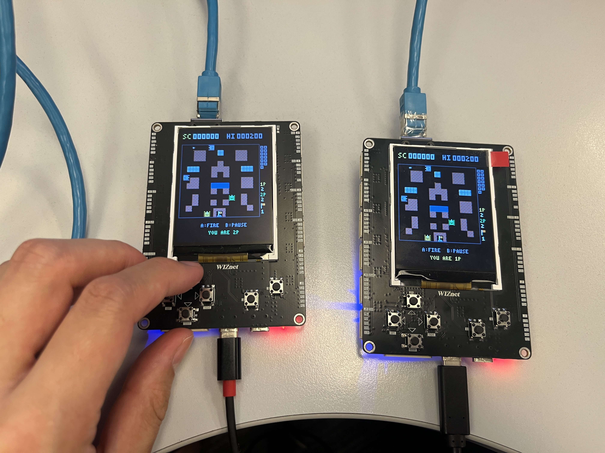

# W55MH32 Mini Console Games

Three mini games for the **WIZnet W55MH32-ADK** board, written in **MicroPython** with an ST7789 display, six buttons and I2S sound. Each game has a one-player mode and a two-board mode played over Ethernet, using the W55MH32's built-in WIZnet hardwired TCP/IP.

The code was mainly written with the help of Claude and tested on real hardware.



## Games

| Game                                    | File           | Modes               | Network (UDP) |
| --------------------------------------- | -------------- | ------------------- | ------------- |
| **BLOCK FALL** (falling-block puzzle)   | `blockfall.py` | SOLO, BATTLE        | port 5005     |
| **TANK BATTLE** (top-down tank shooter) | `tank.py`      | 1 PLAYER, 2P CO-OP  | port 5006     |
| **BUBBLE BLAST** (bubble shooter)       | `bubble.py`    | 1 PLAYER, 2P VERSUS | port 5007     |

A launcher (`main.py`) shows a **GAMES** menu. Choosing a game restarts the board so that the game gets all the free memory.

## Hardware

- WIZnet **W55MH32-ADK** board
- 240 × 320 **ST7789** LCD (on the board, SPI1)
- 6 buttons (on the board)
- **WIZnet I2S module** and a speaker - **WIZM-AUDAMP**
- Ethernet cable (and a router or switch, or a cable directly between two boards, for two-player modes)

### Pins

| Function                       | Pins                                                         |
| ------------------------------ | ------------------------------------------------------------ |
| LCD (SPI1, 36 MHz)             | CS `PC4`, DC `PB0`, RST `PC5`, backlight `PB1`               |
| Ethernet (SPI2, 10 MHz)        | CS `PB12`, RST `PD9`, PWN `PE15` (driven low)                |
| I2S audio (I2S 3, mono 16 kHz) | SCK `PB3`, WS `PA15`, SD `PB5`                               |
| Buttons (active low)           | LEFT `PC6`, RIGHT `PG8`, UP `PA8`, DOWN `PC7`, A `PF13`, B `PF11` |

## Requirements

- MicroPython **[1.27.0](https://docs.w5500.com/reference/w55mh32l_adk.html)** firmware for the W55MH32 with the `st7789py` driver included (frozen into the firmware)
- `mpy-cross` matching your MicroPython version (to build `.mpy` files)
- A tool to copy files to the board, such as **[mpremote / Thonny / other]**

## Install

1. Compile each game on your PC. This is needed because compiling a 20 KB `.py` file on the board runs out of memory:

   ```
   mpy-cross -march=armv7m -O3 blockfall.py
   mpy-cross -march=armv7m -O3 tank.py
   mpy-cross -march=armv7m -O3 bubble.py
   ```

2. Copy these files to the board:

   ```
   main.py
   blockfall.mpy
   tank.mpy
   bubble.mpy
   ```

   The `.py` source files do not need to be on the board.

3. Reset the board. The **GAMES** menu appears.

## Controls

| Where         | Buttons                                                      |
| ------------- | ------------------------------------------------------------ |
| GAMES menu    | UP / DOWN choose, **A** play                                 |
| BLOCK FALL    | LEFT / RIGHT move, **A** rotate, DOWN soft drop, UP hard drop |
| TANK BATTLE   | Direction buttons move, **A** fire, **B** pause              |
| BUBBLE BLAST  | LEFT / RIGHT aim, **A** shoot, UP swap bubble                |
| Title screens | **B** returns to the GAMES menu                              |
| Any game      | Hold **A + B** for the emergency exit                        |

**[Check and correct these controls if any differ on your board.]**

## Two-player setup

1. Use two boards, each with the games installed.
2. On each board, open the game's **SETUP** screen and give the boards **different MAC addresses**.
3. Choose **DHCP** (needs a router) or **STATIC** IPs.
4. Peer: **AUTO** finds the other board by UDP broadcast, or choose **MANUAL** and enter the other board's IP.
5. Choose **SAVE**. The settings are written to a JSON file and the board restarts.
6. Start the same game on both boards and choose the two-player mode.

Settings are saved in `blockfall_cfg.json`, `tank_cfg.json` and `bubble_cfg.json`. TANK BATTLE and BUBBLE BLAST save their settings on first run. In BLOCK FALL, use **SETUP → SAVE** once on each board so the MAC address stays the same. If there is no DHCP server, TANK BATTLE and BUBBLE BLAST use a fallback address in `192.168.77.x` after 8 seconds. BLOCK FALL does not have this fallback.

## How the two-player modes work

- **BLOCK FALL (UDP 5005):** Clearing lines sends garbage rows to the other player. Each board shows the opponent's stack height. The "I lost" message is sent three times.
- **TANK BATTLE (UDP 5006):** Both boards run the same game and exchange only button inputs (lockstep). Inputs are delayed by 2 frames, and each packet repeats the last 8 frames, so a lost packet is covered by the next. The link is lost after 3 seconds of silence.
- **BUBBLE BLAST (UDP 5007):** Each board plays its own field. Garbage attacks are numbered and acknowledged, and re-sent until acknowledged. Field packets also work as a heartbeat (lost after 5 seconds).

## Files

```
main.py            launcher (GAMES menu)
blockfall.py       BLOCK FALL source
tank.py            TANK BATTLE source
bubble.py          BUBBLE BLAST source
```

Files created on the board while playing: `*_cfg.json` (settings), `tank_hi.txt` and `bubble_hi.txt` (high scores).

## Article

**[Insert link to the Hackster.io article]**

## Credits and licence

- Code licence: MIT
- [MicroPython](https://micropython.org/) and the [`st7789py`](https://github.com/russhughes/st7789py_mpy) driver are MIT-licensed. Keep their licence notices if you include their source.
- The BLOCK FALL music is the public-domain Russian folk tune *Korobeiniki*.
- All sprites, stage layouts and sound effects are original.
- WIZnet and W55MH32 are trademarks of WIZnet.
- These games are inspired by classic arcade styles. They are independent projects and are not related to or endorsed by the owners of the original games.
